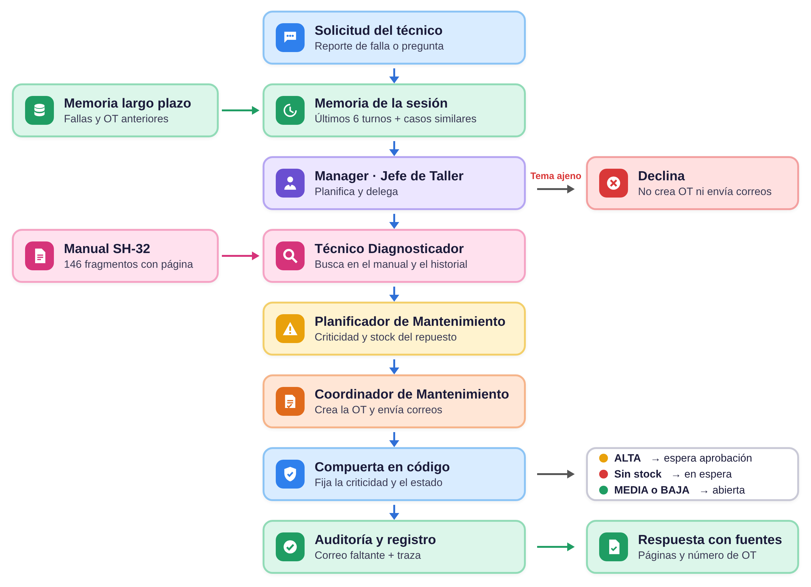

# Agente SH-32

Proyecto académico desarrollado para la asignatura **Ingeniería de Soluciones con Inteligencia Artificial (ISY0101)**.

Integrantes: Diego Cabrera, Luis Muñoz, Aran Opazo y Eric Rubilar.

El proyecto consiste en un agente que atiende reportes de fallas eléctricas de la flota de helicópteros SH-32 en un taller de mantenimiento ficticio. El agente busca información en el manual eléctrico, revisa fallas anteriores, decide qué tan grave es la falla, revisa si hay repuesto, crea una orden de trabajo y avisa a quien corresponde.

## Objetivo

Hoy una persona tiene que hacer todos esos pasos a mano. El objetivo es que un equipo de agentes los haga por su cuenta, deje registro de lo que hizo y deje en manos de una persona los casos graves.

Las fallas de criticidad ALTA nunca se aprueban solas: la orden de trabajo queda esperando la aprobación de supervisión.

## Tecnologías utilizadas

- Python
- Google Colab
- CrewAI (orquestación jerárquica)
- qwen3.8-27b mediante Groq (también funciona con Mistral)
- Sentence Transformers (MiniLM multilingüe)
- FAISS
- LangChain (solo para la búsqueda en el manual)

## Agentes

| Agente | Qué hace | Herramientas |
|---|---|---|
| Jefe de Taller (Manager) | Decide qué hacer con cada solicitud, reparte el trabajo y revisa los resultados | Ninguna, solo delega |
| Técnico Diagnosticador | Encuentra el sistema y el componente con el manual y el historial | `buscar_manual`, `buscar_historial_fallas` |
| Planificador de Mantenimiento | Decide la criticidad y revisa si hay repuesto | `evaluar_criticidad`, `consultar_stock` |
| Coordinador de Mantenimiento | Crea la orden de trabajo y avisa | `crear_orden_trabajo`, `enviar_correo` |

Las herramientas son de tres tipos:

- **Consulta:** `buscar_manual`, `buscar_historial_fallas` y `consultar_stock`.
- **Razonamiento:** `evaluar_criticidad`.
- **Escritura:** `crear_orden_trabajo` y `enviar_correo`.

## Arquitectura



El flujo principal es el siguiente:

1. Llega la solicitud del técnico.
2. Se recupera la memoria de la sesión y los casos parecidos de sesiones anteriores.
3. El Manager decide qué especialistas necesita y en qué orden.
4. Los especialistas usan sus herramientas.
5. El código revisa la orden de trabajo: la criticidad se puede subir pero no bajar, y una falla ALTA queda esperando aprobación.
6. Si falta un correo obligatorio, el sistema lo envía.
7. Se guarda un registro con lo que hizo cada agente y se entrega la respuesta con las páginas del manual y el número de OT.

En `docs/diagramas/` hay más diagramas: la secuencia de una falla en vuelo, las decisiones por escenario y la memoria.

## Memoria

- **Corto plazo:** guarda las últimas 6 solicitudes y respuestas de la sesión. Permite responder preguntas de seguimiento.
- **Largo plazo:** guarda el historial de fallas y cada orden de trabajo creada (FAISS + archivo JSONL). Permite recordar casos de sesiones anteriores.
- **Manual:** 54 páginas divididas en 146 fragmentos que guardan su número de página.

Para saber cuándo una pregunta no tiene relación con el manual se usa un umbral de distancia de **1,261**. Es el punto medio entre la pregunta del manual menos parecida (0,994) y la pregunta sin relación más parecida (1,529). Si el fragmento más cercano supera ese valor, el agente no responde con información inventada.

## Estructura del repositorio

```text
ep2-agente-sh32/
│
├── EP2_Agente_SH32.ipynb
├── README.md
├── requirements.txt
├── .env.example
├── docs/
│   ├── diagramas/
│   └── GUION_DEMO.md
├── evidencias/
└── tests/
    └── prueba_sin_api/
```

- `EP2_Agente_SH32.ipynb`: notebook principal con el agente, las pruebas y los escenarios.
- `docs/diagramas/`: diagramas de la arquitectura.
- `evidencias/`: resultados guardados de la ejecución (órdenes, correos, registros y tablas).
- `tests/prueba_sin_api/`: prueba que ejecuta el notebook completo sin conexión, con un modelo simulado.

## Cómo ejecutar el proyecto

El proyecto está preparado para ejecutarse en **Google Colab**.

1. Abrir `EP2_Agente_SH32.ipynb` en Google Colab.
2. Crear un secreto llamado `LLM_API_KEY` con una API Key de Groq y habilitar el acceso del notebook.
3. Para usar Mistral en vez de Groq, crear también `LLM_BASE_URL` (`https://api.mistral.ai/v1`) y `LLM_MODEL` (`mistral-small-latest`).
4. Ejecutar todo. La primera celda instala las librerías con versiones fijas si faltan; cuando instala, la sesión se reinicia sola y hay que volver a usar **Ejecutar todo**.
5. En la sección 1 aparece el botón para subir `Manual electrico SH-32.pdf`. Si ya está guardado, se puede cancelar.
6. Al final, el notebook descarga un `.zip` con las evidencias.

> La API Key no está incluida en este repositorio. El manual tampoco se incluye, porque tiene prohibición de reproducción.

La cuenta gratuita de Groq permite 200.000 tokens al día con qwen y 7.000 tokens de entrada por minuto. Una ejecución completa usó cerca de 67.000 tokens y unos 25 minutos, por lo que conviene ejecutarla con la cuota del día disponible.

## Casos de prueba

| Caso | Situación | Resultado esperado | Resultado obtenido |
|---|---|---|---|
| A | Falla en tierra, con stock | OT abierta, sin correos | OT-20261023-001 abierta (MEDIA), sin correos |
| B | La misma falla en vuelo | Sube a ALTA, la OT espera aprobación y se avisa a supervisión | ALTA, OT-20261023-002 pendiente de aprobación y correo a supervisión |
| C | Repuesto sin stock | Se avisa a bodega y la OT queda en espera (si la falla queda ALTA, primero espera aprobación) | Correo a bodega y a supervisión; la OT-20261023-003 quedó ALTA esperando aprobación |
| D | Pregunta sin relación con el manual | Declina y no crea nada | Declinó sin delegar ni crear OT |
| E | Pregunta de seguimiento | Responde con la memoria de la sesión | Respondió la OT del TR2 y su estado |
| F | Sesión nueva | Recuerda la OT del TR2 con la memoria de largo plazo | Recordó la OT-20261023-003 desde otra sesión |

Los archivos de esa ejecución están en `evidencias/`. La compuerta y la auditoría no tuvieron que corregir al equipo en ningún caso.

Además, el notebook tiene 9 pruebas de las herramientas que no usan el modelo, por ejemplo que una falla en vuelo quede como ALTA aunque el agente proponga MEDIA. La prueba de `tests/prueba_sin_api/` ejecuta el notebook completo con un modelo simulado y comprueba 14 resultados.

## Limitaciones

Este proyecto corresponde a un prototipo académico.

- El inventario, la flota, el historial y los correos son simulados.
- No está conectado a un sistema de mantenimiento real.
- La criticidad se decide por palabras clave.
- Solo se probaron seis escenarios.
- El Manager usa más tokens que un proceso con pasos fijos.
- La forma en que el Manager reparte el trabajo depende del modelo y puede variar entre ejecuciones.
- En los casos B, C y E la respuesta final quedó cortada por el límite de 800 tokens de salida del Manager; las órdenes y los correos sí quedaron completos. Se corrige subiendo el límite a 900 tokens (Groq gratis no acepta más de 1.000 tokens de salida por minuto) y pidiendo respuestas de máximo 350 palabras.

## Uso de inteligencia artificial

Se utilizó Claude (Anthropic) como apoyo para la base del código del notebook, la revisión de errores, los diagramas y la estructura del README y del informe. [Indicar cómo lo revisó y validó el equipo.] Las pruebas citadas corresponden a las salidas guardadas de la ejecución en Colab.

## Referencias

- Anthropic. (2026). *Claude* [Modelo de lenguaje de gran tamaño]. https://claude.ai
- CrewAI. (2026). *CrewAI documentation*. https://docs.crewai.com/
- Groq. (2026). *GroqCloud documentation*. https://console.groq.com/docs
- LangChain. (2026). *LangChain documentation*. https://python.langchain.com/
- Reimers, N., & Gurevych, I. (2020). Making monolingual sentence embeddings multilingual using knowledge distillation. *Proceedings of EMNLP 2020*, 4512–4525.
- Valenzuela, F. (2026). *Ingeniería de Soluciones con Inteligencia Artificial* [Repositorio, rama Mistral/RA2]. GitHub. https://github.com/fvalenzuelag/Ingenier-a-de-Soluciones-con-Inteligencia-Artificial/tree/Mistral/RA2
- Yao, S., Zhao, J., Yu, D., et al. (2023). ReAct: Synergizing reasoning and acting in language models. *ICLR 2023*.
